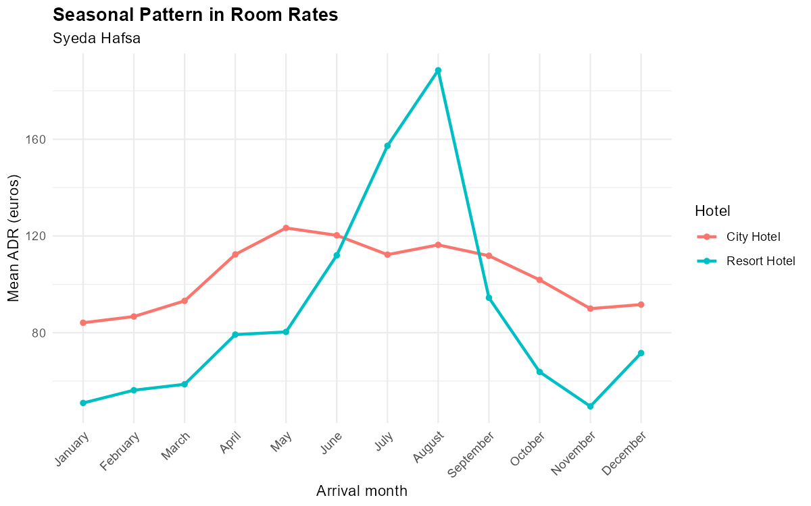
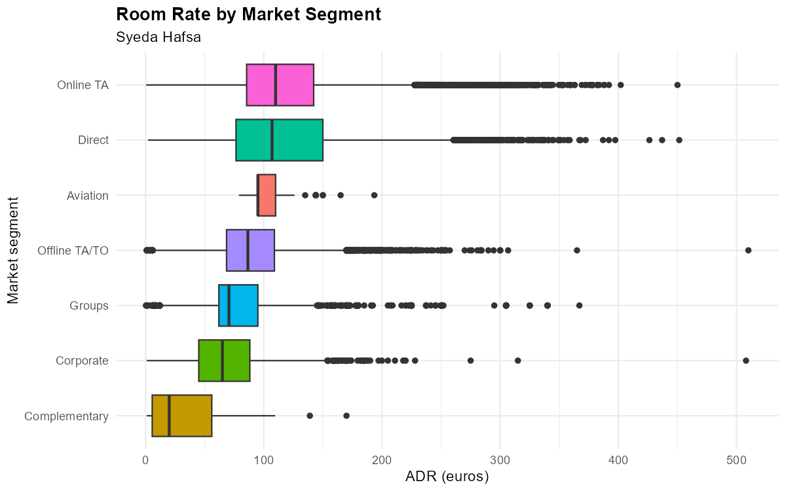
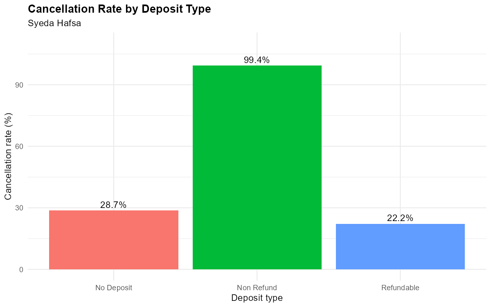
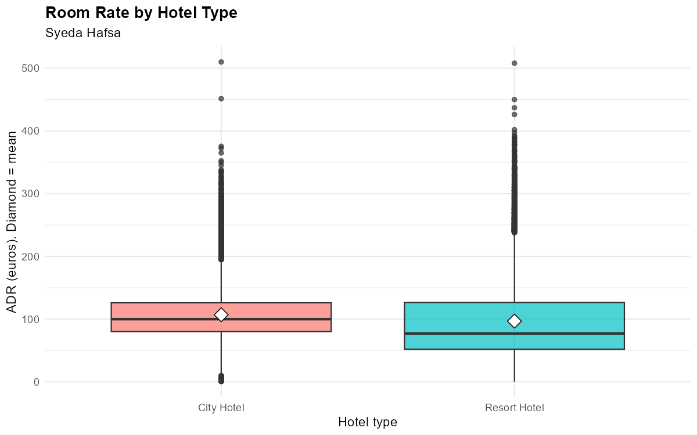
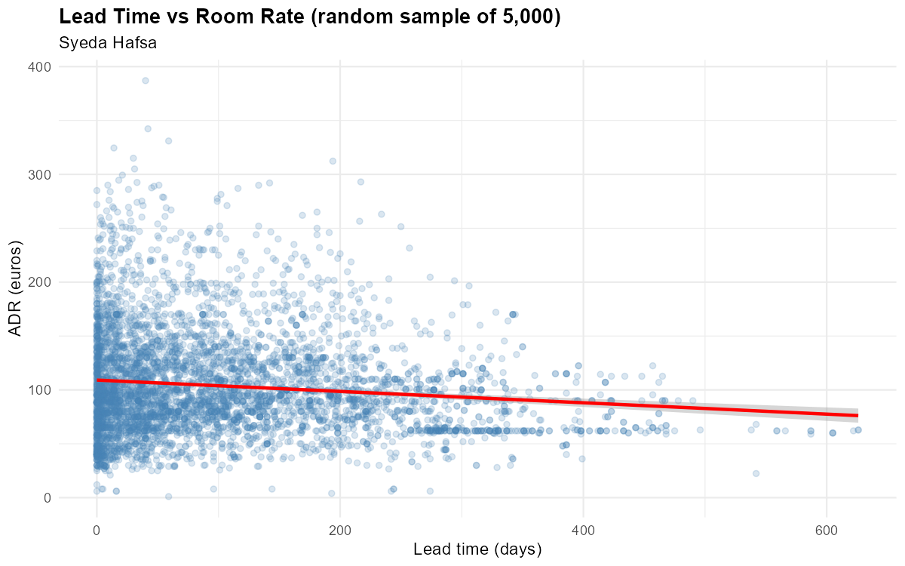

# Hotel Booking Demand: Statistical Analysis in R

What sets the price of a hotel room, and who cancels? A Master of Data Science statistics project at Universiti Kebangsaan Malaysia, analysing 119,390 bookings from a city hotel and a resort hotel in Portugal with hypothesis tests, effect sizes and regression, and ending in an executive memo.

**Case study:** <https://syedahafsa135.github.io/projects/hotel-bookings.html>

## Problem

A hotel room is perishable: an empty room tonight can't be sold tomorrow. Managers must set prices and plan for cancellations at the same time. About 37.5% of the cleaned bookings were cancelled. This project asks which booking characteristics are statistically **and practically** associated with room rate and with cancellation.

**Objectives**
1. Describe the distributions of room rate (ADR), lead time, length of stay, party size and market segment, by hotel.
2. Test relationships: lead time and other features with ADR; deposit type with cancellation.
3. Test differences in mean ADR between hotel types and across market segments.
4. Quantify how much of the variation in ADR booking features and season explain.

## Data

Hotel Booking Demand (Antonio et al. 2019) via TidyTuesday 2020-02-11: 119,390 bookings × 32 variables. The raw CSV is not committed; see [`data/README.md`](data/README.md).

**The hidden missing values.** `is.na()` reported gaps only in `children` (4 rows). But the file stores missing values as the text `"NULL"`. Counting the text revealed about 129,000 hidden gaps: `company` 112,593 (94.3%), `agent` 16,340 (13.7%), `country` 488 (0.4%).

**Cleaning decisions**

| Decision | Reason |
|---|---|
| Dropped `agent` and `company` columns | Mostly "NULL"; not needed for the objectives; imputing would invent information |
| Removed 4 rows with missing `children` | Too few to justify imputation |
| Excluded the €5,400 rate, kept €510 | €5,400 is >10× the next value (entry error); the top tail is otherwise gradual |
| Excluded 1,960 zero or negative rates | Free stays can't be told apart from missing prices; conclusions cover paid stays |
| Removed empty bookings, zero-night stays, "Undefined" segment | Nobody stayed, or the segment can't be interpreted |
| **Result** | 1,996 rows (1.7%) removed, **117,394** left |

## Method

R 4.6.1 with the tidyverse (readr, dplyr, ggplot2) for cleaning and charts, and base R for all tests. α = .05. Effect sizes are reported beside every p-value, because with this many rows almost everything is "significant".

- Welch independent-samples t-test (city vs resort ADR) with Cohen's d
- One-way ANOVA with η², Welch ANOVA check and Tukey post-hoc tests across seven market segments
- Chi-square test of independence (deposit type × cancellation) with Cramér's V
- Pearson correlation and three multiple regression models, with residual diagnostics

## Results

| Question | Test | Result | Effect size |
|---|---|---|---|
| Is the city hotel dearer? | Welch t-test | City €106.89 vs resort €96.77 (≈ €10 more), p < .001 | d = 0.22 (small) |
| Does market segment matter? | ANOVA + Welch + Tukey | 20 of 21 segment pairs differ; only Direct vs Online TA are alike (€0.28, p = .995) | η² = .141 |
| Is deposit type linked to cancelling? | Chi-square | 99.4% of Non Refund bookings cancelled vs 28.7% No Deposit, 22.2% Refundable | Cramér's V = .48 |
| Does lead time drive price? | Correlation | Real but very weak: earlier bookings are slightly cheaper | r = −.091 |
| How much of the rate can we explain? | Multiple regression | Booking features → + arrival month → + hotel × month | Adjusted R² .223 → .414 → .551 |

**Executive memo (six recommendations):**
1. Set prices by season, starting at the resort, where the mean rate swings from about €50 in winter to about €188 in August.
2. Don't rely on a flat "city premium"; set rates by hotel and season.
3. Grow direct bookings and review channel discounts: groups pay about €37 less and corporate about €48 less than online agencies.
4. Treat non-refundable bookings with caution: audit how they're recorded before counting them as secure revenue.
5. Price for the number of guests: each extra guest adds about €27 a night.
6. Don't over-invest in lead-time pricing: 100 days earlier lowers the rate by only about €10.5.

**Charts** (all nine are saved to `figures/` by the script):



| | |
|---|---|
|  |  |
| Rate by market segment (ANOVA, η² = .141) | Cancellation by deposit type (Cramér's V = .48) |
|  |  |
| Rate by hotel (Welch t-test, d = 0.22) | Lead time vs rate (r = −.09) |

Residual diagnostics: [residuals vs fitted](figures/08_residuals_vs_fitted.png), [Q-Q plot](figures/09_qq_residuals.png). Distributions: [lead time](figures/01_lead_time.png), [room rate](figures/02_adr.png).

## How to run

```bash
git clone https://github.com/syedahafsa135/hotel-booking-statistical-analysis-r.git
cd hotel-booking-statistical-analysis-r
# download data/hotels.csv (see data/README.md), then in R once: install.packages("tidyverse")
Rscript R/hotel_analysis.R
```

Or open the folder in RStudio, set the working directory to the repository root, and source `R/hotel_analysis.R`.

## Limitations

- Observational data from two hotels: associations, not causes.
- Zero and invalid rates were excluded, so results describe paid stays only.
- Residuals fan out as the fitted rate grows, and their tail is heavy, so equal variance and normality are only partly met. Read standard errors with care.
- The best model leaves 45% of rate variation unexplained (room type, competitor prices and events aren't recorded). The Non Refund cancellation pattern remains unexplained.
- Next steps: logistic regression for cancellation, robust standard errors or a time-series model.

Author: Syeda Hafsa · [Portfolio](https://syedahafsa135.github.io/) · [LinkedIn](https://www.linkedin.com/in/syeda-hafsa-140324224)
